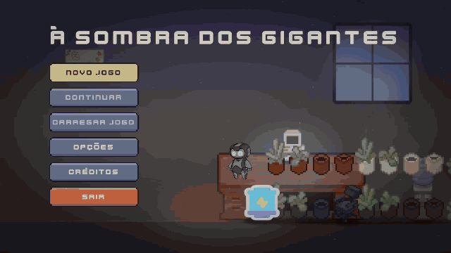
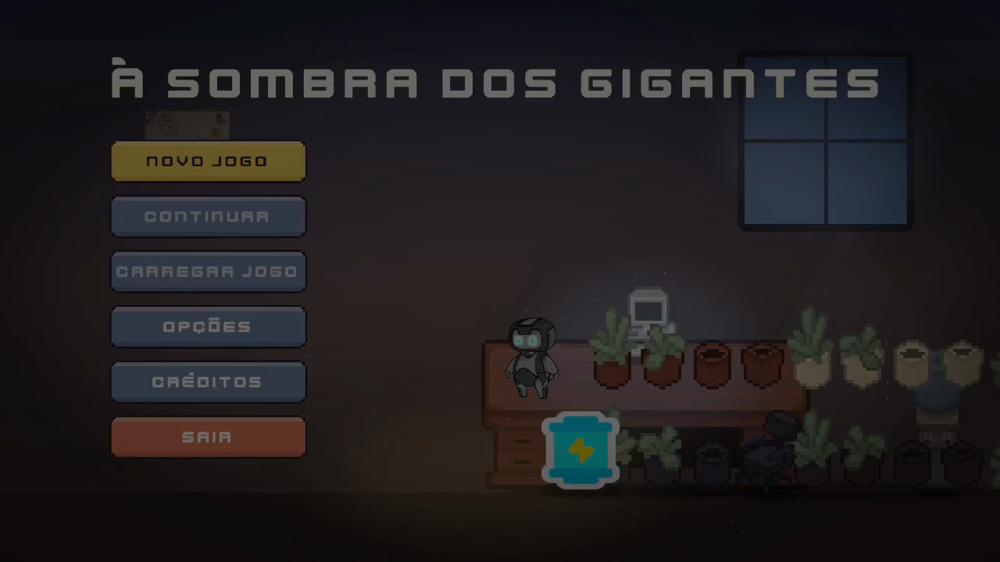
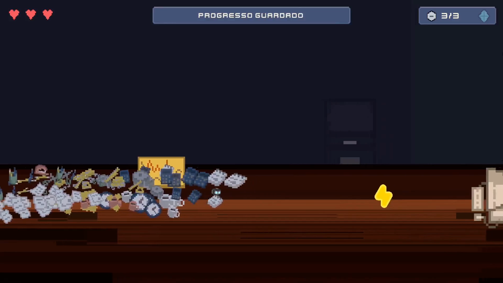
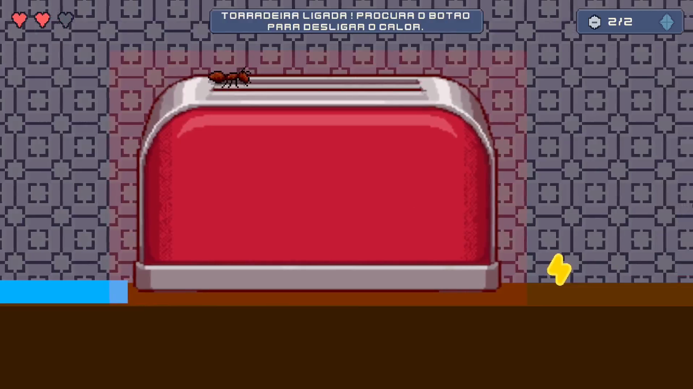
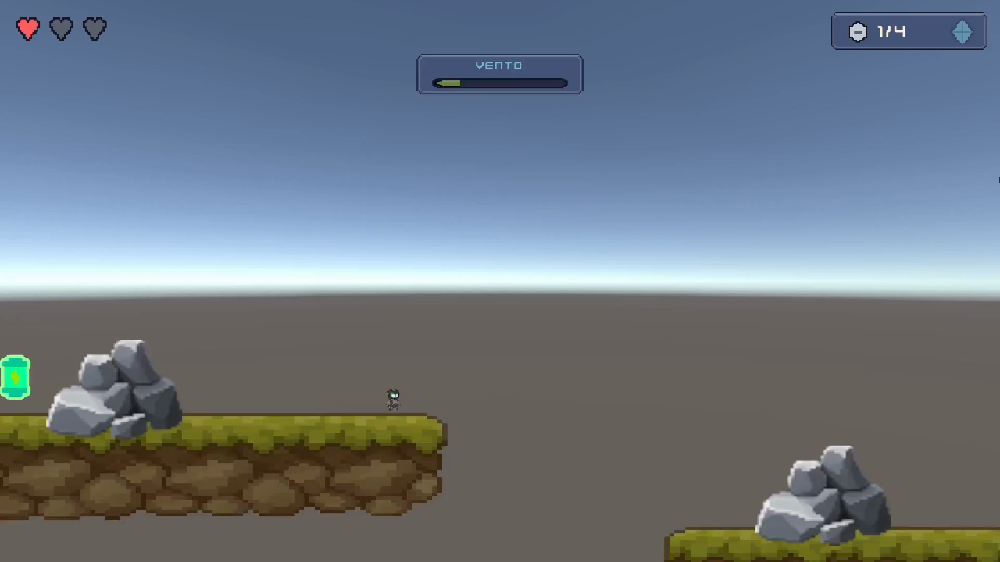

# À Sombra dos Gigantes

> **EN:** 2D puzzle-platformer made in Unity 6 (C#) by a team of three for the Game Development course at Instituto Politécnico de Setúbal (2026). I programmed the global systems (menus, HUD, save/load) and designed Level 1.

Jogo de plataformas e puzzles 2D em pixel art, feito em Unity por um grupo de 3 na cadeira de Desenvolvimento de Videojogos da licenciatura em Engenharia Informática (Instituto Politécnico de Setúbal, 2026).

Controlas o **Mico**, um robô de manutenção do tamanho de uma pilha que ficou preso num apartamento depois de uma experiência de miniaturização falhada. Em cada nível, objetos do dia a dia tornam-se obstáculos ou ferramentas (esponjas que servem de trampolim, torradeiras que queimam, folhas levadas pelo vento) e o objetivo é recuperar a Peça de Escala e chegar à saída.

| | |
|---|---|
| **A minha parte** | Programação dos sistemas globais (menus, HUD, gravação e carregamento) e level design do Nível 1 (escritório) |
| **Equipa** | Gonçalo Alves, Marco Gomes (arte e Nível 3) e Marius Mulear (mecânicas e Nível 2) |
| **Tecnologia** | Unity 6 (6000.4.2f1), C# |

## Funcionalidades

- **Movimento 2D** com aceleração, *coyote time* e *jump buffer*.
- **Puzzles físicos** com objetos empurráveis e botões; perigos temporizados e de contacto.
- **Checkpoints e respawn**, com HUD de vida, colecionáveis e mensagens.
- **Menus completos:** menu principal, opções (incluindo reconfiguração de teclas), pausa e ecrã de loading.
- **Gravação em JSON** com autosave ao entrar no nível e em cada checkpoint. Guarda também um histórico das ações de gravar e carregar, para detetar *save scumming*.
- **Cheats de demonstração** (F1–F6) e um overlay de debug.

## Imagens

| | |
|---|---|
|  |  |
|  |  |

## Decisões de âmbito

Durante o desenvolvimento cortámos o que não acrescentava ao *vertical slice*: os 3 slots de gravação manuais passaram a **1 slot com autosave**, e a ação de agachar foi removida porque nenhum nível a usava. Registámos estas decisões numa adenda ao documento de design (GDD).

## Código

O código-fonte é privado: é um projeto de grupo e usa pacotes de arte de terceiros que não podem ser redistribuídos. Os scripts que escrevi (gravação, menus, HUD, controlador do jogador e mecânicas do Nível 1, cerca de 3 000 linhas de C#) posso mostrá-los numa entrevista.
